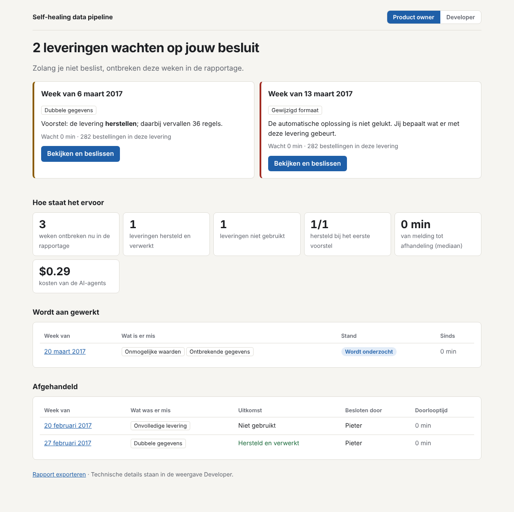
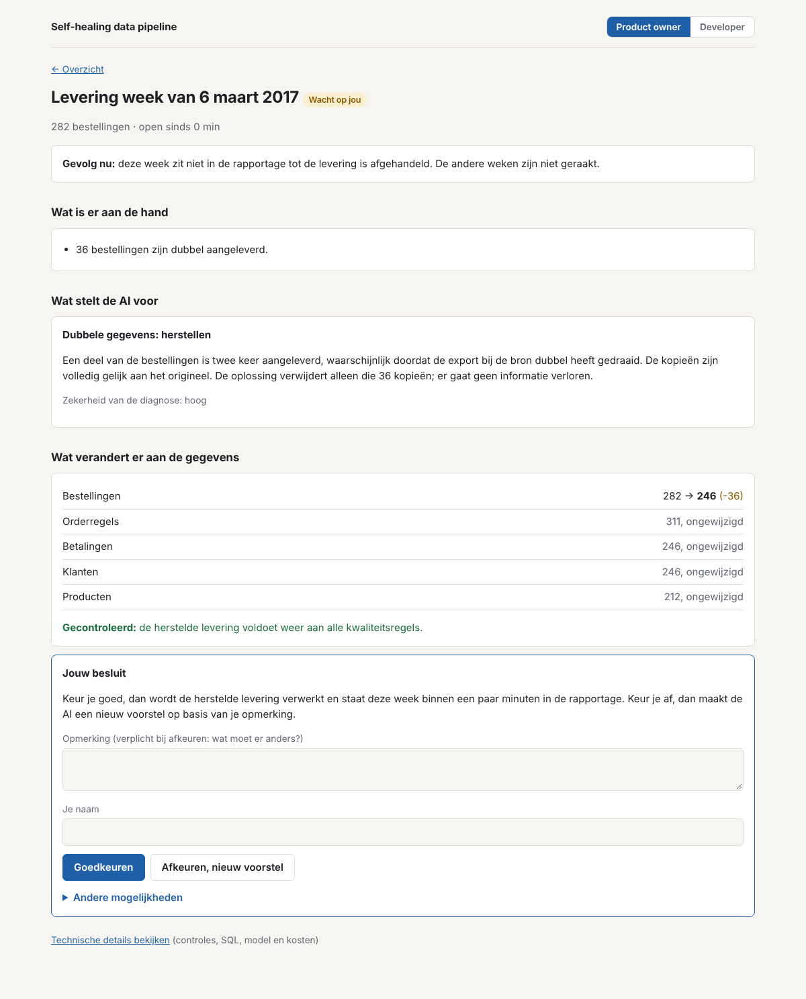
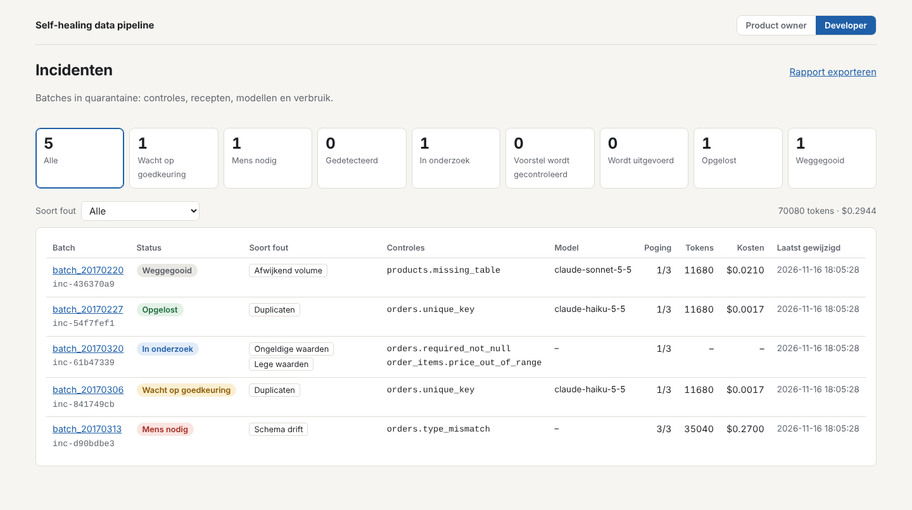

# Self-healing data pipeline (proof of concept)

Een lokaal draaiende opstelling die laat zien hoe een data pipeline fouten in aangeleverde data zelf opvangt:

1. Een **chaos-agent** verstoort af en toe een batch.
2. De **pipeline** (Airflow + dbt + DuckDB) vindt de fout met een dbt-model per soort fout en zet de batch in quarantaine.
3. De **healer** laat per soort fout een Claude-agent op een passend model de oorzaak onderzoeken en een herstelrecept schrijven.
4. De pipeline controleert de herstelde batch met dezelfde dbt-modellen.
5. Jij keurt goed of af in de **console** (HTML). Pas daarna komt de batch in de marts.

Dataset: [Brazilian E-Commerce (Olist)](https://www.kaggle.com/datasets/olistbr/brazilian-ecommerce) van Kaggle, opgeknipt in weekbatches.

## Starten

Nodig: Linux met Docker en Docker Compose.

```bash
cp .env.example .env
```

Vul in `.env` je `ANTHROPIC_API_KEY` in, en `KAGGLE_USERNAME` en `KAGGLE_KEY`. Zonder Kaggle-account kun je `DATASET=synthetic` zetten; dan draait alles op nagemaakte data met dezelfde kolommen.

```bash
make up
```

| Wat | Waar |
|---|---|
| Console: incidenten, oplossingen, goedkeuren | http://localhost:8000 |
| Airflow | http://localhost:8080 |

De bron levert elke twee minuten een week aan. De eerste vier batches blijven schoon (referentie voor het volume); daarna wordt ongeveer één op de drie verstoord. Wil je niet wachten:

```bash
make chaos TYPE=schema_drift
```

Geldige types: `null_spike`, `duplicates`, `invalid_values`, `referential_integrity`, `volume_anomaly`, `schema_drift`.

Overige commando's: `make logs`, `make report` (statisch `data/console/report.html`), `make down`, `make clean` (ook alle data weg).

## Opbouw: vijf losse componenten

Elke map is een zelfstandig onderdeel met een eigen image, eigen afhankelijkheden en eigen opslag. Geen component importeert code van een ander. Ze delen alleen de contracten in `contracts/`.

| Component | Doet | Weet niets van |
|---|---|---|
| `source/` | Speelt het bronsysteem na: Olist ophalen en per week afleveren | alles stroomafwaarts |
| `chaos/` | Koerier tussen bron en pipeline; verstoort soms een batch en logt wat hij deed | pipeline, agents |
| `pipeline/` | Airflow + dbt: controleren, quarantaine, marts | Claude, agents |
| `console/` | Incidentregister (REST) en het HTML-scherm | Airflow, dbt, Claude |
| `healer/` | Claude-agents: diagnose en herstelde batch | Airflow, dbt, het warehouse |

```
source ──► outbox/ ──► chaos ──► landing/ ──► pipeline ──► marts
                                                 │ fout gevonden
                                                 ▼
                                   quarantine/<batch>/ + incident ──► console
                                                 │                      ▲   │
                                              healer ── voorstel ───────┘   │ besluit
                                                 │                          ▼
                                   candidates/<incident>/ ──► pipeline: controleren, daarna inlezen
```

De componenten zijn op twee manieren gekoppeld:

- **Uitwisselmappen** onder `data/`, elk met één schrijver. Lezers krijgen de map read-only gemount.
- **De console-API**, de enige plek waar de status van een incident leeft. Pipeline en healer vragen die periodiek op; niemand roept een ander rechtstreeks aan.

Drie keuzes die daaruit volgen:

- **De healer komt nooit in het warehouse.** Hij werkt op een kopie van de batch in een in-memory DuckDB waarin externe toegang uit staat. SQL van een agent kan daardoor niets buiten die kopie lezen of schrijven.
- **Een fix is een herstelde batch plus het recept (SQL)**, geen wijziging aan dbt-code of aan productiedata. Het alternatief is de batch weggooien.
- **Alleen de pipeline beoordeelt of data goed is.** De healer keurt zijn eigen werk niet. Ook na jouw goedkeuring gaat de kandidaat nog één keer door de controles voordat hij wordt ingelezen.

Elk onderdeel is los te draaien. `make core` start alleen bron en pipeline: foute batches belanden dan in `data/quarantine/` en worden alsnog gemeld zodra de console erbij komt. Zonder healer kun je in de console een batch zelf weggooien of ongewijzigd vrijgeven.

Details van de berichten, mappen en statussen: [`contracts/README.md`](contracts/README.md).

## Soorten fouten

| Soort | Voorbeeld | dbt-model | Claude-model |
|---|---|---|---|
| `null_spike` | `customer_id` leeg in 20% van de rijen | `dq_null_spike` | Haiku 5.5 |
| `duplicates` | orders dubbel aangeleverd | `dq_duplicates` | Haiku 5.5 |
| `invalid_values` | negatieve prijs, bedrag ×1000, datum in de toekomst | `dq_invalid_values` | Sonnet 5.5 |
| `referential_integrity` | orderregels zonder order | `dq_referential_integrity` | Sonnet 5.5 |
| `volume_anomaly` | een fractie van het normale volume, ontbrekend bestand | `dq_volume_anomaly` | Sonnet 5.5 |
| `schema_drift` | kolom hernoemd, komma als decimaalteken | `dq_schema_drift` | Opus 5.5 |

- De dbt-modellen staan in `pipeline/dbt/models/quality/`. Drempels staan als `vars` in `dbt_project.yml`.
- Welk model welke fout behandelt staat in `healer/routing.yml`, samen met de denkdiepte, het maximum aantal stappen en de prijs per token voor de kostenschatting.
- De instructies per soort fout staan in `healer/prompts/`.
- Voor Sonnet en Opus staat de server-side fallback van de Claude API aan: weigert een veiligheidsfilter een verzoek, dan neemt een ander model het over. Uitzetten kan per route met `fallbacks: false`.

Zit er in één batch meer dan één soort fout, dan behandelt de healer ze na elkaar op dezelfde werkkopie, schema drift eerst. Je keurt per batch goed, omdat een batch als geheel wordt ingelezen.

## De console

Eén console, twee weergaven. Je wisselt rechtsboven; de keuze wordt onthouden. Beide weergaven tonen dezelfde incidenten en hebben dezelfde besluitknoppen.

**Product owner** (standaard): gewone taal, geen SQL.

- Bovenaan staat wat op jouw besluit wacht, per week, met het voorstel en wat er aan gegevens vervalt.
- Kerncijfers: weken die nu in de rapportage ontbreken, herstelde en niet-gebruikte leveringen, hoe vaak het eerste voorstel goed was, doorlooptijd en kosten van de AI.
- Per levering: wat er aan de hand is, wat de AI voorstelt (een samenvatting die de agent speciaal voor deze lezer schrijft), wat er per soort gegeven verandert, en het besluit.





**Developer**: alles om een voorstel te beoordelen en te debuggen.

- Overzicht per batch met status, gefaalde controles, model, poging, tokens en kosten; filter op status en soort fout.
- Per incident: de bevindingen per controle met voorbeeldsleutels, diagnose met bewijs, het SQL-recept, rijaantallen voor en na, de tijdlijn, paden naar de quarantainebundel en de kandidaat, en de ruwe JSON.
- Na afloop: wat de chaos-agent werkelijk deed en of detectie en diagnose klopten. De healer krijgt dat log nooit te zien.



In beide weergaven kun je goedkeuren, afkeuren met een opmerking (de healer probeert het opnieuw met jouw tekst als feedback), de levering laten vervallen, of hem ongewijzigd verwerken. Na drie mislukte pogingen (instelbaar met `MAX_ATTEMPTS`) is het aan een mens.

## Geheimen buiten de repo houden

Sleutels staan alleen in `.env`, dat door git en Docker wordt genegeerd. Zet na het klonen eenmalig de pre-commit hook aan:

```bash
make hooks
```

De hook blokkeert een commit waarin een API-key, een private key, een ingevulde sleutelvariabele of een bestand als `.env` of `kaggle.json` klaarstaat. De regels staan in `scripts/check_secrets.py`; `make test` draait dezelfde controle over alles wat git volgt.

## Tests

```bash
python -m venv .venv && . .venv/bin/activate && pip install -r requirements-dev.txt
```

```bash
make test
```

De tests draaien zonder Docker en zonder Claude. Elk component heeft eigen tests in zijn map. In `tests/` staan de tests over de componenten heen:

- `test_detection.py`: elke verstoring van chaos wordt door het bijbehorende dbt-model gevangen, en schone batches geven geen bevindingen.
- `test_e2e.py`: de hele lus met een echte console-server en een nagespeeld Claude-model, tot en met gelijke rijaantallen in de marts als bij een run zonder chaos.

## Beperkingen

- Geen login op de console of op Airflow. Alleen lokaal gebruiken.
- De healer herstelt per batch. Een blijvende wijziging in het bronsysteem (een kolom die voortaan anders heet) levert elke week een nieuw incident op.
- De echte Olist-data loopt in de laatste weken van 2018 leeg. Die weken geven terechte volume-incidenten zonder dat chaos iets deed; de console toont dat na afloop.
- Kosten in de console zijn een schatting op basis van de prijzen in `healer/routing.yml`.
